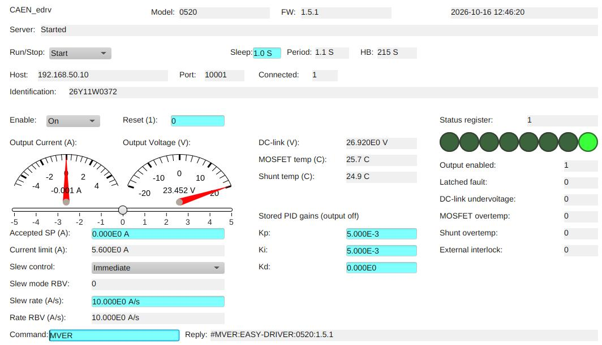

# epicsdev_ps_caen_easydriver
EPICS PVAccess server for **CAEN EASY-DRIVER** power supplies.

Requires Python 3.11 or newer. The package includes `epicsdev` for the server
and `phoebusgen` for generating the Phoebus operator interface.

This server implements remote control over TCP/IP using the EASY-DRIVER command set from:

- `misc/programming_manual.pdf`

and exposes the same operational PV names as in:

- `misc/devEasyDriver.db`

## Implemented PVs

The server hosts these PVs (same names as the DB records):

- `Version`
- `Enable`
- `Reset`
- `SlewControl`
- `Setpoint`
- `BulkVoltage`
- `RegulatorTemp`
- `ShuntTemp`
- `OutputVoltage`
- `SupplyOn`
- `GenericFault`
- `FETovertemp`
- `ShuntOvertemp`
- `DCunderV`
- `ExternalInterlock1`
- `CurrentRBV`
- `SlewControlRBV`
- `ControllerKp`
- `ControllerKi`
- `ControllerKd`

Additional PVs are `Model`, `Identification`, `CurrentLimit`, `Status`,
`Connected`, `SlewRate`, `SlewRateRBV`, `host`, `port`, and `dateTime`.
`Status` is the eight-bit register from the manual: output enabled (bit 0),
fault (1), DC undervoltage (2), MOSFET overtemperature (3), shunt
overtemperature (4), and external interlock (5).

## Command mapping summary

Runtime polling and status use:

- `MST` → status bits
- `MRI` → current readback
- `MRV` → output voltage
- `MRP` → bulk/DC-link voltage
- `MRT` → MOSFET temperature
- `MRTS` → shunt temperature

Startup reads `MVER` for model and firmware version, `MRID` for identification,
and `MRG` for the current limit and stored PID gains.

Control operations use:

- `MON` / `MOFF` → enable/disable output
- `MRESET` → reset status/fault state
- `MWI` / `MRM` → setpoint write (immediate/ramped)
- `MWG` + `MPUP` → controller gains (`Kp`, `Ki`, `Kd`)
- `MRG` → read stored gain values
- `MWSR` / `MRSR` → write/read ramp slew rate (0-1000 A/s)

Startup only reads hardware configuration; it never enables the output or
replays saved current setpoints. `CurrentLimit` comes from EEPROM cell 4;
`--range` can reduce, but cannot increase, this limit. `Setpoint` records the
last accepted server write, not a queried hardware setpoint. It initializes
to zero and resets to zero after `MON`, as specified by the manual.
`SlewControl` selects the server's `MWI`/`MRM` command policy, and its readback
is local to the server. PID gain writes require the output to be off and write
EEPROM before applying the settings with `MPUP`.

Commands and replies are CR-terminated. Failed puts return a PVAccess error;
failed polling retains the last valid measurements and clears `Connected`.
Broken connections are reopened on the next transaction, without replaying
the failed command. Exiting the server closes TCP but does not turn off the supply.

## Installation

From this project directory, install the server and OPI generator dependencies:

```bash
python -m pip install .
```

For development, use an editable installation instead:

```bash
python -m pip install -e .
```

## Running

Example:

```bash
python -m epicsdev_ps_caen_easydriver --host 192.168.0.10 --port 10001
```

Useful options:

- positional `device` prefix base (default: `caen_edrv`)
- `-i, --instance` device instance (default: `0`)
- `--host` EASY-DRIVER IP/host (default: `192.168.0.10`)
- `--port` EASY-DRIVER TCP port (default: `10001`)
- `--timeout` socket timeout in seconds (default: `2.0`)
- `--range` restrict setpoint magnitude in A (default: hardware limit)

Use `python -m epicsdev_ps_caen_easydriver --help` for all server options.

The published PV prefix is:

- `<device><instance>:`

With defaults, PVs are published as:

- `caen_edrv0:<PVName>`

## Phoebus OPI

Example operator interface: [caen_edrv0.bob](opi/caen_edrv0.bob).



Generate the operator interface from this project directory:

```bash
python opi/generate_opi.py
```

The [generator](opi/generate_opi.py) writes `opi/caen_edrv0.bob` with the
default PV prefix `pva://caen_edrv0:`. Open the generated screen in Phoebus
with PVAccess support enabled and the server running.

The screen includes server controls, device identification and connection
status, output current and voltage meters, a current setpoint slider and
entry, slew settings and readbacks, temperatures, stored PID gains, and the
status register with individual status flags. Write `1` to `Reset` to reset
the module status register. PID gain writes require the output to be off.

To use another server prefix and screen title:

```bash
python -m epicsdev_ps_caen_easydriver magnet -i 1 --host 192.168.0.10
```

In another terminal, from this project directory:

```bash
python opi/generate_opi.py --title "Magnet 1" pva://magnet1:
```

The prefix must include the trailing colon. The title and prefix options do
not change the output filename: the generator still writes
`opi/caen_edrv0.bob`, replacing any existing screen at that path.

## Tests

Run from this project directory with its dependencies installed:

```bash
python -m unittest discover -s tests -v
```

The tests use simulated device replies and do not connect to a physical supply.
